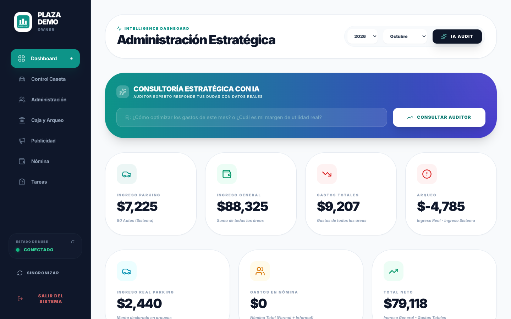
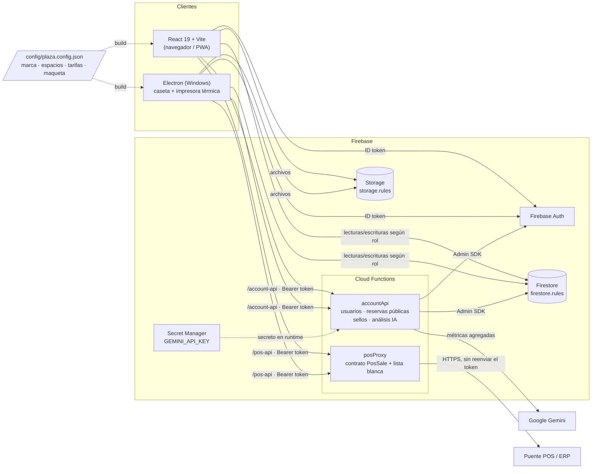

# Explanada

[**Abrir demo**](https://aloner23.github.io/Explanada/) · [Caso de estudio](docs/CASO-DE-ESTUDIO.md) · [Arquitectura](docs/ARQUITECTURA.md) · [Seguridad](docs/SEGURIDAD.md) · [Pruebas](#pruebas-y-verificación)

**Recorrido de 2 minutos:** abre la demo, pulsa **Acceso Interno** e inicia con `dueno` / `demo1234` para explorar el tablero. Después prueba `cajero` para ver el flujo de estacionamiento. Son cuentas de demostración y datos ficticios; el backend de Pages es simulado y el análisis de IA devuelve un ejemplo.

**Plataforma de administración para plazas comerciales.** Estacionamiento con tickets QR y cola offline, locatarios y cobranza, reservas de espacios para eventos, nómina, publicidad, contabilidad con catálogo SAT, un auditor estratégico con IA y un cliente de escritorio para la caseta. Es *white-label*: nombre, logo, colores, espacios, tarifas, locales y maqueta 3D salen de un solo archivo de configuración.

Nació como un sistema a la medida que construí para una plaza comercial real en producción; esta es la versión generalizada.

[](https://github.com/Aloner23/Explanada/actions/workflows/ci.yml)


> **English summary.** Explanada is an open-source, white-label management platform for shopping plazas and mixed-use centers. It covers QR-ticket parking with an offline-tolerant atomic payment queue, tenant billing and collections, bookings for configurable event spaces, payroll, advertising, SAT-style accounting and a Gemini-powered strategy dashboard whose API key stays server-side. Everything plaza-specific (name, logo, brand colors, bookable spaces and prices, parking tariff rules, units, currency, tax settings and a JSON-described 3D master plan) lives in `config/plaza.config.json`. External POS/ERP systems plug in through a small adapter interface (mock and HTTP adapters included). Stack: React 19, TypeScript, Vite, Zustand, Firebase (Auth, Firestore, Storage, Cloud Functions, Secret Manager) and Electron. Try it with `npm run demo:mock` (in-browser mock backend, no accounts needed) or `npm run demo` (Firebase Emulators with the real security rules).



---

## Qué resuelve

| Antes | Con Explanada |
|---|---|
| Tickets de papel y cortes de caja a mano, sin forma de cruzar lo cobrado contra lo declarado | Tickets con QR y código de barras, tarifa calculada por reglas configurables (tolerancia, locatario, convenios, pensión, tope diario) y **arqueo por turno** con faltantes y sobrantes |
| Si se cae el internet, la caseta deja de registrar o duplica cobros | Ticket y transacción se guardan **en un solo lote atómico**. Sin conexión, el lote entra a una **cola por usuario** y se reenvía al volver la red |
| Rentas, servicios y adeudos en hojas de cálculo | Expediente por locatario (contrato, m², servicios, depósito), tablero de cobranza y recordatorios por WhatsApp |
| Reservas de salones por mensaje | Página pública con disponibilidad y solicitud de reserva con **folio opaco**, sin exponer datos de otros clientes |
| El dueño no tiene una vista consolidada | Dashboard por año y mes, desglose por unidad de negocio **y por espacio**, y un **auditor con IA** que redacta el análisis con las cifras reales |

## Funciones por rol

| Rol | Qué hace | Captura |
|---|---|---|
| **Público** | Landing con galería, master plan 3D interactivo, servicios, espacios y precios. Solicita una reserva y consulta o cancela su folio | [landing](docs/screenshots/01-landing-publica.png) · [3D](docs/screenshots/02-master-plan-3d.png) |
| **Dueño (`OWNER`)** | Dashboard estratégico: ingresos por categoría y por espacio, egresos, neto, ocupación, morosidad, saturación de agenda. Auditor IA con preguntas libres | [dashboard](docs/screenshots/04-dashboard-dueno.png) |
| **Administración (`ADMIN`)** | Locatarios y contratos, pensionados, cobranza, agenda de eventos, movimientos, contabilidad (pólizas, balanza, XML SAT, CFDI), galería, equipo, ajustes y sincronización con el POS | [locatarios](docs/screenshots/05-admin-locatarios.png) · [cobranza](docs/screenshots/06-admin-cobranza.png) · [agenda](docs/screenshots/07-admin-agenda.png) · [contabilidad](docs/screenshots/08-admin-contabilidad.png) · [nómina](docs/screenshots/09-nomina.png) · [arqueo](docs/screenshots/10-caja-arqueo.png) |
| **Cajero (`PARKING_STAFF`)** | Caseta: entrada y salida por escaneo o folio, cobro, visitas, pensionados, convenios, corte de turno e impresión térmica silenciosa desde Electron | [caseta](docs/screenshots/11-caseta-estacionamiento.png) |
| **Locatario (`TENANT`)** | Portal propio: estado de cuenta e historial de pagos. Sella tickets de sus clientes escaneando el QR (descuento validado en el servidor) | [portal](docs/screenshots/12-portal-locatario.png) |
| **Staff (`STAFF`)** | Tablero de tareas asignadas | — |

## Adaptarlo a tu plaza

Todo lo específico de una plaza está en [`config/plaza.config.json`](config/plaza.config.json). El repositorio trae una plaza ficticia, **Plaza Demo**:

```jsonc
{
  "name": "Plaza Demo",
  "logo": "logo.png",
  "colors": { "primary": "#0d9488", "accent": "#f59e0b", "dark": "#0f172a" },
  "locale": "es-MX", "currency": "MXN",
  "tax": { "vatRate": 0.16, "pricesIncludeTax": true, "taxIdLabel": "RFC" },
  "parking": { "hourlyRate": 15, "freeMinutes": 15, "dailyMax": 200, "tenantRateDiscount": 5,
               "partnerConvention": { "label": "Convenio comercio aliado", "freeHours": 3 } },
  "spaces": [
    { "id": "salon-a",   "name": "Salón A",   "kind": "hall",      "capacity": 150, "pricing": { "base": 4500 } },
    { "id": "terraza",   "name": "Terraza",   "kind": "outdoor",   "capacity": 250, "pricing": { "base": 5000, "weekend": 9000, "holiday": 12000 } },
    { "id": "coworking", "name": "Coworking", "kind": "coworking", "capacity": 40,  "pricing": { "base": 2500 } }
  ],
  "locales": [{ "id": "A-101", "type": "LOCAL", "areaM2": 45 } /* … */],
  "layout": { "lot": { "width": 120, "depth": 80 }, "buildings": [/* … */], "parking": [/* … */], "greens": [/* … */] },
  "pos": { "adapter": "mock" }
}
```

1. Copia el archivo y edita marca, contacto, espacios, tarifas y locales. Solo `name` es obligatorio; lo demás tiene valores por defecto.
2. Reemplaza `public/logo.png` (y opcionalmente `public/watermark.png`, la marca de agua de los tickets).
3. Describe tu maqueta en `layout` (rectángulos en metros) o bórrala: se genera una automáticamente a partir de los locales y espacios.
4. Compila con tu archivo: `PLAZA_CONFIG=config/mi-plaza.config.json npm run build`.

El archivo se valida al arrancar: un id de espacio repetido, un precio negativo o un adaptador POS desconocido detienen la app con un mensaje claro. La referencia completa está en [docs/CONFIGURACION.md](docs/CONFIGURACION.md).

### POS / ERP

Los cobros se registran siempre en Firestore. Reflejarlos en un POS externo es opcional y se hace con un **adaptador**: `disabled`, `mock` (en memoria, para demos) o `http`, que envía un `PosSale` genérico al proxy `posProxy` y de ahí a tu puente (`POST /sales`, `GET /health`). Para integrar un ERP concreto basta con un puente que hable ese contrato o con un adaptador propio que implemente `PosAdapter`. Detalles en [docs/POS.md](docs/POS.md).

## Arquitectura



Más detalle (capas, *scopes* de carga, modelo de datos, flujo offline) en [docs/ARQUITECTURA.md](docs/ARQUITECTURA.md).

## Seguridad: puntos destacados

Todo lo siguiente está implementado y probado. Detalle en [docs/SEGURIDAD.md](docs/SEGURIDAD.md).

- **Reglas de Firestore por rol.** Cada petición lee el perfil `plz_users/{uid}`: una cuenta desactivada pierde el acceso aunque su token siga vigente. Un locatario solo lee su expediente y sus transacciones; el cajero solo crea transacciones `PARKING`/`VISIT`/`AUDIT` y no puede alterar la hora de entrada de un ticket. Las colecciones desconocidas se niegan por defecto.
- **Perfiles y roles solo desde el servidor.** `plz_users` tiene `allow write: if false`. Altas, roles y contraseñas pasan por `accountApi` (token verificado con revocación, perfil activo, solo un `OWNER` toca a otro `OWNER`, nadie se quita su propio acceso, contraseñas nunca en Firestore, *rollback* de Auth si falla el perfil).
- **Cobro atómico y cola offline por usuario.** Ticket y transacción van en un `writeBatch`; sin red, el lote completo se encola y se reproduce igual. La caché y la cola tienen clave por `uid` y una cola heredada no se reproduce bajo otra identidad.
- **La clave de IA no llega al cliente.** El navegador envía métricas agregadas a `/account-api/analysis`; la función (solo `OWNER`/`ADMIN`, con límite de tasa) usa `GEMINI_API_KEY` desde Secret Manager y traduce los errores del proveedor a códigos sin filtrar la clave.
- **HTML generado saneado** con lista blanca de etiquetas y sin atributos antes de `dangerouslySetInnerHTML`.
- **Proxy POS con contrato fijo.** Solo `POST /sales`, `GET /sales/:ref` y `GET /health`; el token de Firebase no se reenvía; HTTPS obligatorio; sin redirecciones.
- **Endpoints públicos mínimos.** La disponibilidad pública no incluye nombres, correos ni folios; las reservas públicas nacen `pending`; 20 solicitudes por hora por IP (hash).
- **Electron endurecido.** `sandbox`, `contextIsolation`, sin `nodeIntegration`, navegación bloqueada, IPC solo desde el frame principal e impresión en una ventana sin JavaScript con CSP `default-src 'none'`.
- **La configuración es pública por diseño.** `plaza.config.json` se empaqueta en el cliente; los secretos viven en Secret Manager y `functions/.env`.

## Probar el demo

Requisitos: Node 22. El modo con emuladores también necesita Java 21 o posterior.

```bash
npm install
npm --prefix functions install

# Opción A — sin Java: backend simulado en el navegador (no evalúa firestore.rules)
npm run demo:mock     # http://localhost:3000

# Opción B — Firebase Emulators (reglas reales, Functions reales, proyecto demo-plaza)
npm run demo          # siembra datos sintéticos y abre http://localhost:3000
```

Pulsa **Acceso Interno** e inicia sesión con cualquiera de estos usuarios (contraseña `demo1234`):

| Usuario | Rol |
|---|---|
| `dueno` | OWNER |
| `admin` | ADMIN |
| `cajero` | PARKING_STAFF |
| `staff` | STAFF |
| `locatario` | TENANT (Café Aurora, A-101) |

En el demo, Gemini no está conectado: el auditor devuelve un texto de ejemplo en el modo simulado y avisa que no está configurado en el modo con emuladores. El POS usa el adaptador `mock`. Para un proyecto real copia `.env.example` y `functions/.env.example`, despliega con `firebase deploy` y crea la primera cuenta `OWNER` (Auth + documento `plz_users/{uid}` con `role: "OWNER"` y `active: true`) desde la consola de Firebase.

### Demo en GitHub Pages

`.github/workflows/pages.yml` compila el modo simulado con base `/Explanada/` (`npm run build:pages`) y lo publica en GitHub Pages al hacer push a `main`, una vez que Pages esté habilitado en el repositorio (Settings → Pages → Source: GitHub Actions). Todos los datos viven en el navegador del visitante.

## Pruebas y verificación

```bash
npm run typecheck     # tsc --noEmit
npm test              # 27 pruebas: tarifas, caché por usuario, lote offline atómico, saneo HTML,
                      # lista blanca POS, auditor IA, paginación, sesión, plaza.config,
                      # maqueta generada, precios por fecha, ingresos por espacio, adaptadores POS
npm run test:firebase # reglas de Firestore/Storage y endpoints HTTP contra emuladores (Java 21)
npm run build         # build de producción en dist/
npm run build:mock    # build del demo simulado en dist-mock/
```

La integración continua (`.github/workflows/ci.yml`) ejecuta `typecheck`, `test`, `build` y `build:mock` en cada push, y en un job aparte instala Java 21 y corre `test:firebase`.

## Estructura

```
config/plaza.config.json  configuración de la plaza (ejemplo: Plaza Demo)
src/
  config/                 carga, validación y utilidades de la configuración (plaza.ts, plazaLogic.ts)
  App.tsx                 enrutamiento por rol y cortes automáticos de turno
  components/             ParkingSystem, OwnerDashboard, AdminPanel, TenantManager, CashAudit,
                          AccountingView, PayrollManager, PublicLanding, PlanSection3D…
  services/               dataService (caché + cola offline), authService, geminiService,
                          posService + pos/ (adaptadores), printService, accountingService…
  store/useStore.ts       estado global (Zustand) con snapshots inmutables
  utils/                  parkingLogic (tarifas), financialCalculations, safeHtml, cachePrivacy…
  tests/                  pruebas unitarias, de reglas y de integración
functions/                Cloud Functions: accountApi, posProxy, análisis IA
electron/                 proceso principal + preload (impresión térmica)
demo/                     datos sintéticos, seed de emuladores y backend simulado
docs/                     ARQUITECTURA, SEGURIDAD, CONFIGURACION, POS, capturas
```

## Stack

**Frontend:** React 19, TypeScript 5.8, Vite 6, Zustand 5, Tailwind, Recharts, Three.js con @react-three/fiber y drei, Framer Motion, html5-qrcode, JsBarcode, qrcode, lucide-react.
**Backend:** Firebase Auth, Firestore, Storage, Cloud Functions (Node 22, Express) y Secret Manager.
**Escritorio:** Electron con electron-builder.
**Pruebas:** `node:test`, jsdom y `@firebase/rules-unit-testing` contra los Firebase Emulators.

## Roadmap

- [ ] Varias plazas en un mismo proyecto (multi-tenant con `plazaId` en reglas y colecciones).
- [ ] Editor visual de `layout` para dibujar la maqueta desde el navegador.
- [ ] Textos de la UI en inglés (i18n) además de español.
- [ ] Contabilidad desacoplada del catálogo SAT para otros países.
- [ ] Adaptadores POS de referencia para puentes comunes y webhook de confirmación.
- [ ] Pagos en línea para reservas y pensiones.
- [ ] División del bundle (carga diferida de la maqueta 3D y la contabilidad).

## Licencia

[MIT](LICENSE) © 2026 Carlos ([Aloner23](https://github.com/Aloner23)). Los datos del demo, la "Plaza Demo" y su logotipo son ficticios.
