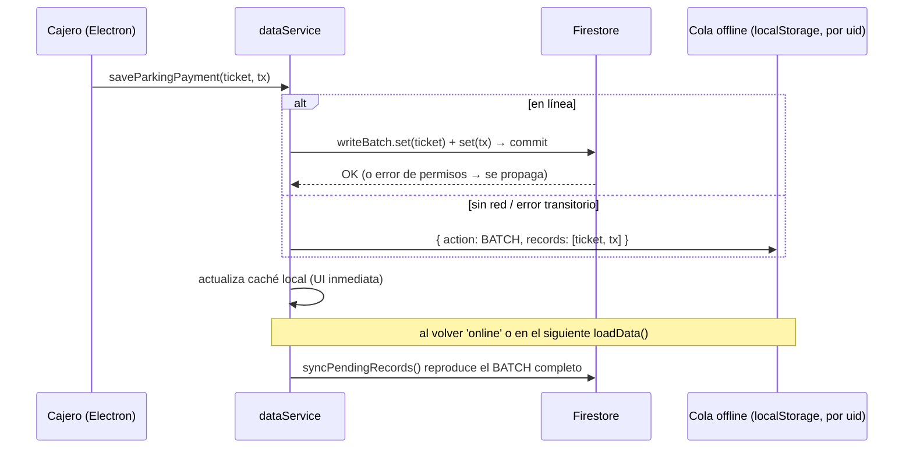

# Arquitectura

## Vista general

Explanada es una SPA de React con un backend *serverless* en Firebase. La misma build sirve en tres contextos:

1. **Navegador / móvil**: Firebase Hosting sirve `dist/` y reescribe `/account-api/**` y `/pos-api/**` hacia las Cloud Functions (`firebase.json`).
2. **Escritorio Windows (Electron)**: la caseta de estacionamiento carga `dist/index.html` desde `file://` y usa el `preload` para listar impresoras e imprimir tickets en silencio. Como `file://` no tiene origen HTTP, `apiBase()` antepone `VITE_API_BASE_URL` a las rutas de API.
3. **Demo local**: Firebase Emulators (`npm run demo`) o un backend simulado en memoria (`npm run demo:mock`).



## Capas del cliente

| Capa | Archivos | Responsabilidad |
|---|---|---|
| UI | `src/components/**` | Vistas por rol. `App.tsx` decide qué sección se monta según `authenticatedUser.role`. |
| Estado | `src/store/useStore.ts` | Store de Zustand. `loadData(scope)` carga solo las colecciones del *scope* de la sección activa (`DATA_SCOPES`). `syncFromLocalCache()` refleja escrituras locales **sin releer Firestore**. Los snapshots se clonan con `structuredClone` para que la caché mutable no altere renders anteriores. |
| Datos | `src/services/dataService.ts` | Lectura por *scope*, paginación por meses de las transacciones históricas (lotes paralelos de 6 meses, con corte tras 6 meses vacíos), fusión de la nube con la caché por `updated_at`, lápidas temporales contra la "resurrección" por consistencia eventual, cola offline y diagnóstico de conexión. |
| Sesión | `authService.ts`, `useSessionGuard.ts`, `useAppInitialization.ts` | Login con alias interno de correo (hash SHA-256 del nombre de usuario). Restauración de sesión leyendo el perfil **desde el servidor** (`getDocFromServer`). Un listener `onSnapshot` del propio perfil cierra la sesión al desactivar la cuenta. |
| Dominio | `utils/parkingLogic.ts`, `utils/financialCalculations.ts`, `services/accountingService.ts` | Tarifas (tolerancia, locatario, convenios, pensión, tope diario), clasificación de ingresos y egresos por unidad de negocio, pólizas, balanza y XML de Contabilidad Electrónica SAT. |
| Configuración | `config/plaza.config.json`, `src/config/plaza.ts`, `src/config/plazaLogic.ts` | Marca, colores, espacios rentables, tarifas, locales, moneda, impuestos y maqueta 3D de la plaza. Se valida al arrancar (`normalizePlazaConfig`). Ver [CONFIGURACION.md](CONFIGURACION.md). |
| Integraciones | `posService.ts` + `services/pos/*`, `geminiService.ts`, `printService.ts`, `emailService.ts` | POS/ERP mediante adaptadores intercambiables (ver [POS.md](POS.md)), auditor IA vía `accountApi`, impresión térmica (QR + código de barras + marca de agua) y correos con EmailJS (modo simulación si no se configura). |

### *Scopes* de carga

```ts
PUBLIC:   config, reservations, gallery            // vía /account-api/public-snapshot
DASHBOARD: config, tenants, transactions, reservations, staff
PARKING:  config, tickets, transactions (últimos 30 días), frequent_customers
TENANT:   solo su tenant + sus transacciones (query where tenantId == …)
ADMIN:    todas las colecciones; transacciones paginadas por mes
```

El *scope* `TENANT` replica en el cliente la misma restricción que imponen las reglas, de modo que el locatario nunca lanza consultas que serían rechazadas.

## Backend (Cloud Functions)

`functions/index.js` expone dos apps de Express:

### `accountApi`
| Ruta | Auth | Descripción |
|---|---|---|
| `GET /public-snapshot` | pública | Configuración pública, galería y disponibilidad futura (`select('date','startTime','endTime','hallName','spaceId','status')`). |
| `POST /reservation` | pública + límite de tasa | Valida formato y crea `RES-<uuid>` en estado `pending` con `create()` (nunca sobrescribe). |
| `POST /reservation-lookup` | pública + límite de tasa | El folio UUID funciona como capacidad: permite consultar o pedir cancelación. Los folios antiguos (cortos) requieren atención de administración. |
| `POST /analysis` | `OWNER`/`ADMIN` + límite de tasa | Llama a Gemini con la clave de Secret Manager. |
| `POST /users` | `OWNER`/`ADMIN` | Alta y edición de cuentas en Auth y Firestore con *rollback*. |
| `POST /stamp` | `TENANT` | Sella un ticket activo dentro de una transacción de Firestore (idempotente: un ticket ya sellado devuelve 409). |

### `posProxy`
Reenvía al puente POS/ERP solo las rutas del contrato genérico (`POST /sales`, `GET /sales/:ref`, `GET /health`; lista blanca en `functions/security.js`). Permite el acceso a `OWNER`, `ADMIN` y `PARKING_STAFF`. Tiene `timeout` de 240 s, `maxRedirects: 0` y devuelve un error genérico sin filtrar la respuesta del POS.

## Modelo de datos (Firestore)

| Colección | Contenido |
|---|---|
| `plz_users` | Perfil por UID de Auth: `role`, `active`, `tenantId`, `permissions`. Nunca contraseñas. |
| `plz_tenants` | Expediente del locatario: local, tipo (LOCAL/OFICINA/DEPORTIVO), renta, servicios, contrato. |
| `plz_tickets` | Ticket de estacionamiento: `entryTime` (inmutable según las reglas), tipo, convenio, estado y pago. |
| `plz_transactions` | Libro único de movimientos: RENT, PARKING, RESERVATION (con `spaceId`), EXPENSE, PAYROLL, AUDIT, HISTORICAL… |
| `plz_reservations` | Solicitudes y eventos de los espacios configurados (`spaceId` + `hallName`). |
| `plz_staff`, `plz_attendance`, `plz_payroll` | Nómina semanal y asistencia. |
| `plz_ad_spaces`, `plz_tasks`, `plz_gallery`, `plz_frequent_customers` | Publicidad, tareas, galería pública y pensionados. |
| `plz_accounts`, `plz_policies`, `plz_cost_centers`, … | Contabilidad (catálogo SAT, pólizas, centros de costo). |
| `plz_rate_limits` | Contadores de la API pública (solo el servidor accede, denegado en las reglas). |

El prefijo `plz_` es neutro. Cada plaza va en su propio proyecto de Firebase: las reglas suponen una sola plaza por base de datos.

## Master plan 3D

`PlanSection3D.tsx` dibuja la plaza con @react-three/fiber a partir de `plaza.config → layout`: un lote rectangular, edificios (`retail`, `office`, `events`, `outdoor`, `sports`, `food`, `service`), filas de estacionamiento y áreas verdes, todos como rectángulos en metros. Si la configuración no trae `layout`, `resolveLayout` genera uno a partir de los locales y espacios. Las texturas (fachadas, techos, asfalto, cajones) son procedurales en canvas; no hay fotografías ni geometría real de ningún predio.

## Modo demo

- `demo/data.mjs` genera un conjunto determinista de datos sintéticos con fechas relativas a "hoy".
- `demo/seed-emulators.mjs` lo carga en los emuladores con el Admin SDK y crea las cuentas de Auth con el mismo alias de correo que usa producción. Se niega a ejecutarse si no hay `*_EMULATOR_HOST` o si el proyecto no empieza por `demo-`.
- `demo/mock/*` sustituye los módulos `firebase/app|auth|firestore|storage` mediante alias de Vite (`--mode mock`) e intercepta `fetch` para `/account-api` y `/pos-api`. Sirve para recorrer la UI y generar las capturas, pero **no** evalúa `firestore.rules`.
