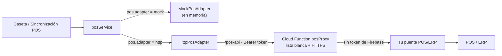

# Integración con POS / ERP

Explanada registra cada cobro de estacionamiento primero en Firestore (ticket y transacción en un solo lote atómico). Reflejar esa venta en un punto de venta o ERP externo es un paso **opcional**, que se hace mediante un **adaptador** intercambiable.



## Elegir un adaptador

En `config/plaza.config.json`:

```json
"pos": { "adapter": "mock", "terminalId": "CAJA-1", "branchId": "1" }
```

| `adapter` | Uso |
|---|---|
| `disabled` | Sin integración. La pantalla "Sincronización POS" muestra un aviso y no se envía nada. |
| `mock` | Adaptador en memoria. Genera folios `MOCK-1001`, `MOCK-1002`… Útil para demos y pruebas. |
| `http` | Envía las ventas al proxy `posProxy`, que las reenvía a `POS_API_URL` (`functions/.env`). |

`terminalId` y `branchId` se pueden sobrescribir desde la pantalla de sincronización (se guardan en `plz_config`).

## Contrato genérico (`PosSale`)

El adaptador HTTP habla un contrato pequeño y estable. Tu puente debe implementar:

| Método | Ruta | Cuerpo / respuesta |
|---|---|---|
| `POST` | `/sales` | Cuerpo `PosSale` → `{ "folio": "F-123" }` |
| `GET` | `/sales/:externalRef` | Opcional: consulta de una venta ya enviada |
| `GET` | `/health` | `{ "ok": true }` |

El proxy rechaza con 403 cualquier otra ruta o método (`functions/security.js`).

```jsonc
{
  "externalRef": "tx-3F2A…",        // id de la transacción en Explanada (clave de idempotencia)
  "terminalId": "CAJA-1",
  "branchId": "1",
  "currency": "MXN",
  "pricesIncludeTax": true,
  "taxRate": 0.16,
  "items": [
    { "sku": "PARKING-HOUR", "description": "Servicio de estacionamiento",
      "quantity": 3, "unitPrice": 15, "discountPct": 55.5556, "total": 20 }
  ],
  "payments": [{ "method": "CASH", "amount": 20 }],   // CASH | CARD | TRANSFER | MEMBERSHIP | OTHER
  "createdAt": "2026-10-13T18:05:00.000Z"
}
```

- `quantity` son las horas facturables a la tarifa configurada; la diferencia con lo cobrado (tolerancias, tarifa de locatario, convenios, membresías) se expresa como `discountPct`.
- **Idempotencia:** el puente debe devolver el mismo folio si recibe dos veces el mismo `externalRef` (la pantalla de sincronización permite reintentar).
- Si el puente no devuelve `folio`, la venta queda marcada con error y se puede reintentar.

## Conectar un ERP concreto

Hay dos caminos:

1. **Puente externo (recomendado).** Un servicio pequeño (Cloud Run, un servidor en la oficina detrás de HTTPS, etc.) que recibe `PosSale` y llama a la API propia de tu ERP. No requiere cambios en el cliente, y las credenciales del ERP nunca salen de ese servicio.
2. **Adaptador propio en el cliente.** Implementa la interfaz `PosAdapter` (`src/services/pos/types.ts`) y regístralo en `selectAdapter()` de `src/services/posService.ts`, o en tiempo de ejecución con `posService.use(miAdaptador)`.

```ts
export interface PosAdapter {
  readonly id: string;
  readonly enabled: boolean;
  submitSale(sale: PosSale): Promise<PosSaleResult>;   // debe lanzar error si falla
  healthCheck?(): Promise<boolean>;
}
```

## Seguridad

- El token de Firebase **no** se reenvía al POS; el proxy solo manda `Accept` y `Content-Type`.
- Solo `OWNER`, `ADMIN` y `PARKING_STAFF` pueden usar el proxy.
- Se exige HTTPS; una excepción HTTP requiere `POS_ALLOW_HTTP=true` y que `POS_API_URL` coincida exactamente con `POS_HTTP_EXCEPTION_URL`.
- `maxRedirects: 0` evita que una redirección lleve el proxy a otro host.

Las pruebas `src/tests/plaza.test.cjs` cubren el armado del `PosSale`, la idempotencia del adaptador simulado y el manejo de errores del adaptador HTTP; `src/tests/security.test.cjs` cubre la lista blanca del proxy.
